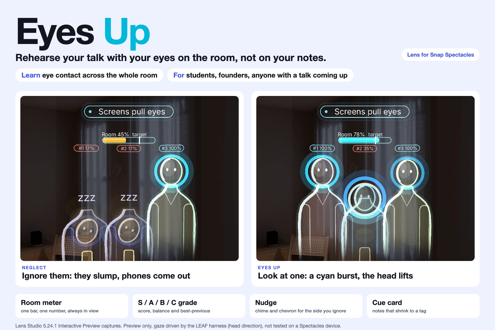
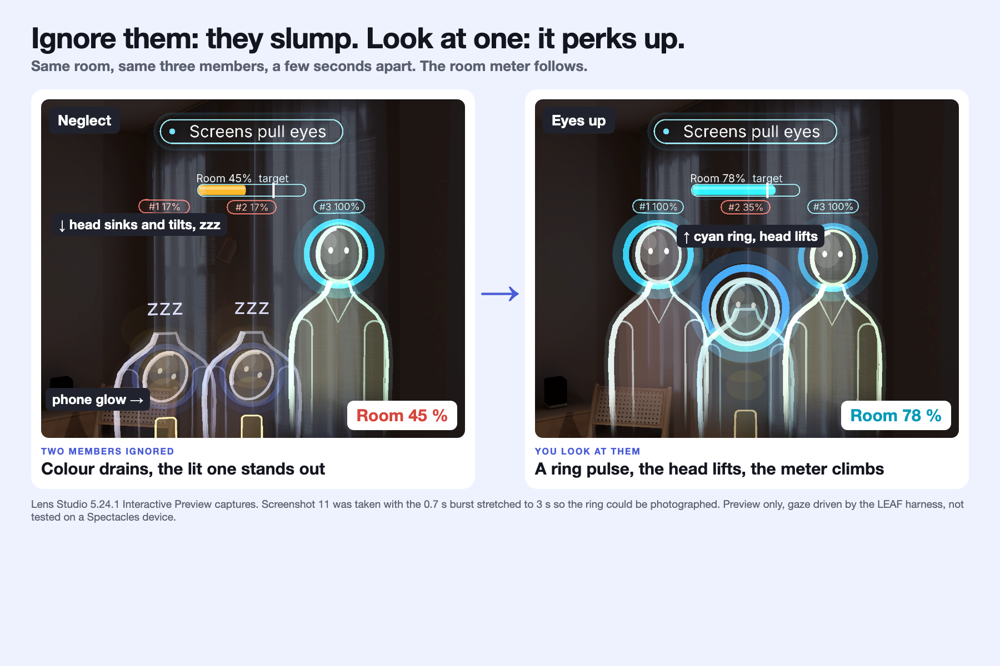
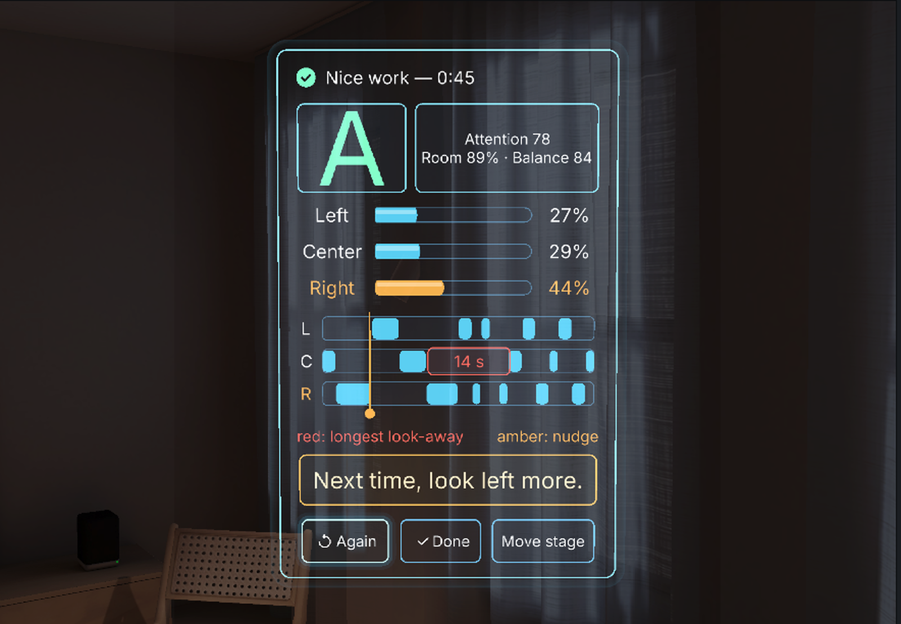
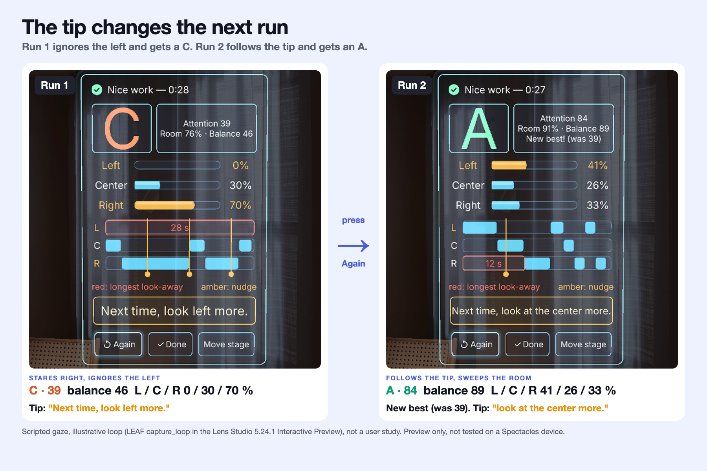
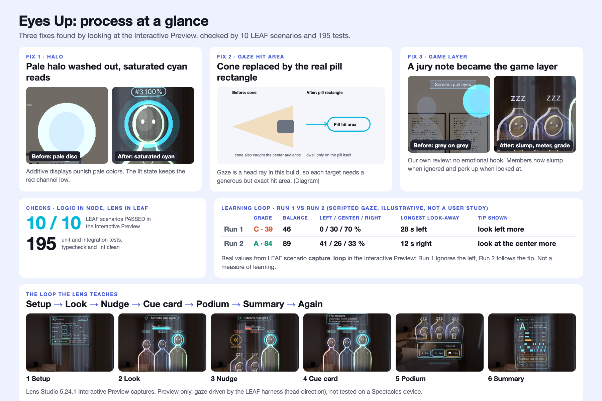
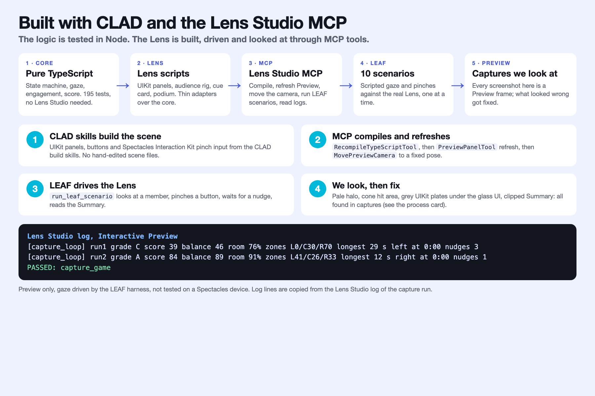
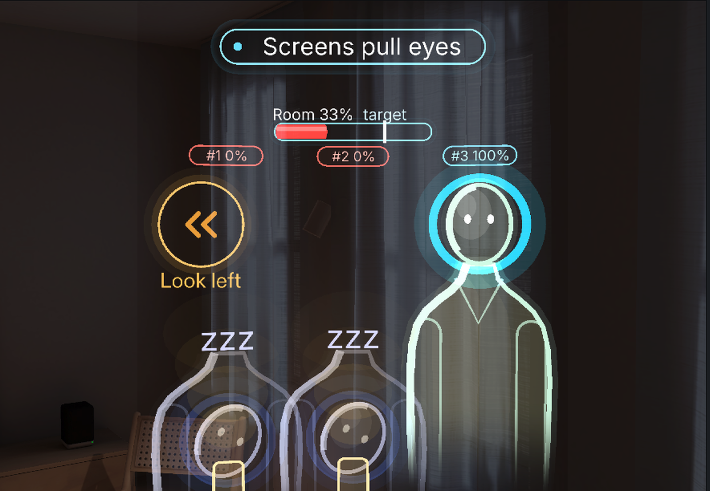

# eyes-up



**Eyes Up** is a presentation rehearsal coach for Spectacles, built for Devpost "Learn AR with SPECS". Rehearse your talk with your eyes on the room, not on your notes. **Learn:** eye contact across the whole room. **For:** students, founders, anyone with a talk or an interview coming up.

**Ignore your audience and they slump; look at them and they perk up.**

> **Judge in 60 seconds:** (1) the hero above and the slump-to-perk-up image below are the whole idea: ignored members slump and light a phone, the one you look at stays lit in cyan, the room meter shows the room. (2) the Summary ([`06-summary.png`](devpost/screenshots/06-summary.png)) and the Run 1 (C 39) vs Run 2 (A 84) image ([`12-run-compare.png`](devpost/screenshots/12-run-compare.png)): the tip changes the next run. (3) [`devpost/leaf-results.md`](devpost/leaf-results.md) and [`13-clad-mcp.png`](devpost/screenshots/13-clad-mcp.png): 10 of 10 LEAF scenarios PASSED, how CLAD and the Lens Studio MCP were used. Preview only, gaze driven by the LEAF harness, untested on a device.

1. **Problem:** people rehearse staring at slides, a phone or a script, so the room never gets practice.
2. **Spatial moment:** a virtual audience sits 2.5 m ahead and reacts to where you look: the member you face lights up and perks up, the ones you ignore slump and light a phone, and after 8 s a chime and chevron point to the side you forgot.
3. **Proof:** built with CLAD and the Lens Studio MCP. LEAF 10/10 and 195 tests pass in the Interactive Preview; gaze = head direction, driven by the LEAF harness. **Preview only, not tested on a device.**

**Learning goal:** spread your eye contact across the whole room. **Feedback:** the audience reacts live, then you get one tip and a grade. **Practice:** press Again and beat your grade. *Limit: learning outcomes are not measured; preview only, gaze is head direction driven by the LEAF harness, untested on a device.*

**Gallery** (Interactive Preview captures, preview only):








**Who learns what:** a *student* practises eye contact with every committee member at a defence; a *founder* keeps eyes on the room instead of the deck and sees which side they forgot; an *interviewee* learns to share eye contact between interviewers.

More screenshots: [01 setup](devpost/screenshots/01-setup-panel.png), [02 halo](devpost/screenshots/02-audience-lit-halo.png), [04 cue card](devpost/screenshots/04-cue-card.png), [05 podium](devpost/screenshots/05-podium.png).

**Learning loop, Run 1 vs Run 2** (scripted gaze, illustrative loop, not a user study; real values from LEAF scenario `capture_loop`):

| | Grade | Balance | Left / Center / Right | Longest look-away | Tip shown |
|---|---|---|---|---|---|
| Run 1: ignores the left | C (39) | 46 | 0 / 30 / 70 % | 29 s, left | look left more |
| Run 2: follows the tip | A (84) | 89 | 41 / 26 / 33 % | 12 s, right | look at the center more |

**What I learned building AR** (details in `devpost/learnings.md` and `devpost/screenshots/09-process-at-a-glance.png`): additive displays wash out pale colours; gaze is a head ray, so hit areas must be exact and the scene must fit a narrow view; test the logic in Node and drive the Lens with CLAD and MCP.

**How it was built:** a pure-TypeScript core (state machine, gaze, engagement, nudge, score, view models; Node-tested), CLAD skills for the scene and UIKit panels, Lens Studio MCP tools for edits, camera moves, LEAF runs and captures. Build log: `devpost/build-notes.md`.

Built for Learn AR with SPECS (deadline 2026-11-09 PST). Preview-only is acceptable, no device required.

- Audience placement with camera transform, gaze via head rotation
- Halo on the watched audience member, chime plus arrow for the neglected side
- Game layer: audience engagement (slump, phone glow, perk-up burst), room attention meter, attention score with an S/A/B/C grade and a best-previous compare (session memory only)
- Cue card on pinch only

## Status

- **Scene built** in Lens Studio 5.24.1, driven entirely through the Lens Studio MCP tools (no hand-edited scene files).
- **10 LEAF scenarios pass** in the Interactive Preview: `start_places_audience`, `gaze_fills_halo`,
  `neglect_triggers_nudge`, `next_shows_card_then_pill`, `dwell_expands_pill`, `finish_shows_summary`,
  `repeated_nudge`, `finish_pulses_at_time`, `neglect_disengages_then_recovers`, `finish_gives_grade` (results: `devpost/leaf-results.md`). Node checks:
  `npm run check` (typecheck, lint, 194 vitest tests).
- **Preview only, not tested on a Spectacles device.** Gaze is head rotation, simulated by LEAF in tests.
- **Nudge chevron placement rule** (`Assets/Scripts/core/ChevronPlacement.ts`): the chevron is a bold double chevron on a round dark backing disc with a "Look left" / "Look right" caption; it keeps its
  edge-of-view spot; panels (podium, cue card), the room meter and every member's whole silhouette are projected into its view
  plane each frame so it slides onto free wall (or, if there is none, avoids what it can) rather than covering them. Unit tested.
- **Demo video:** 1:33, narrated and captioned, opening on the hero halo frame and a drawn "Eyes drop" card, then live preview footage (Setup, pinch, audience, halo; the disclosure shows for the first 2 s, then a PREVIEW pill stays on screen). Gaze, nudge and podium clips play in real time, the cue clip at x1.3 (badged on screen), the Summary is a still capture with a zoom to the timeline, and a card shows three real before/after pairs. `scripts/video/build-video.mjs` builds it from Lens Studio preview footage. YouTube: **TODO_PASTE_PUBLIC_YOUTUBE_URL_HERE**
  (the upload needs the entrant's account).
- Setup: segmented 3/5/10 min and 3/6/9 audience buttons (selected = cyan; audience defaults to 3 so the whole room fits the lens viewport), deck list, optional
  "Import text" deck typed on the AR keyboard. The summary has Again / Done / Re-place.
- Devpost text: `devpost/submission.md`.
- Build log and design decisions: `devpost/build-notes.md`. Screenshots: `devpost/screenshots/`.

## Made with

Lens Studio 5.24.1, SPECS base template, Spectacles Interaction Kit, UIKit, LEAF, CLAD skills and the
Lens Studio MCP tools. Sound effects are generated locally, the video narration is macOS text to
speech, no third-party music or logos.

## Scripts and tests

The pure logic (state machine, gaze, halo attention, nudge rules, cue card, stage-line timer, session
stats, panel view models) does not depend on Lens Studio, and Node tests it. Only `EyesUpApp.ts`,
`Podium.ts`, `SetupPanel.ts` and `SummaryPanel.ts` use Lens Studio APIs.

```bash
npm install
npm test           # vitest: unit + integration (tests/integration simulates a full rehearsal)
npm run typecheck  # tsc with a minimal Lens Studio shim (typings/), for Node-side checking only
npm run lint
npm run check      # all three
```

`tsconfig.json` is the Lens Studio-side config. `tsconfig.test.json` is the Node-side config.

## License

MIT
