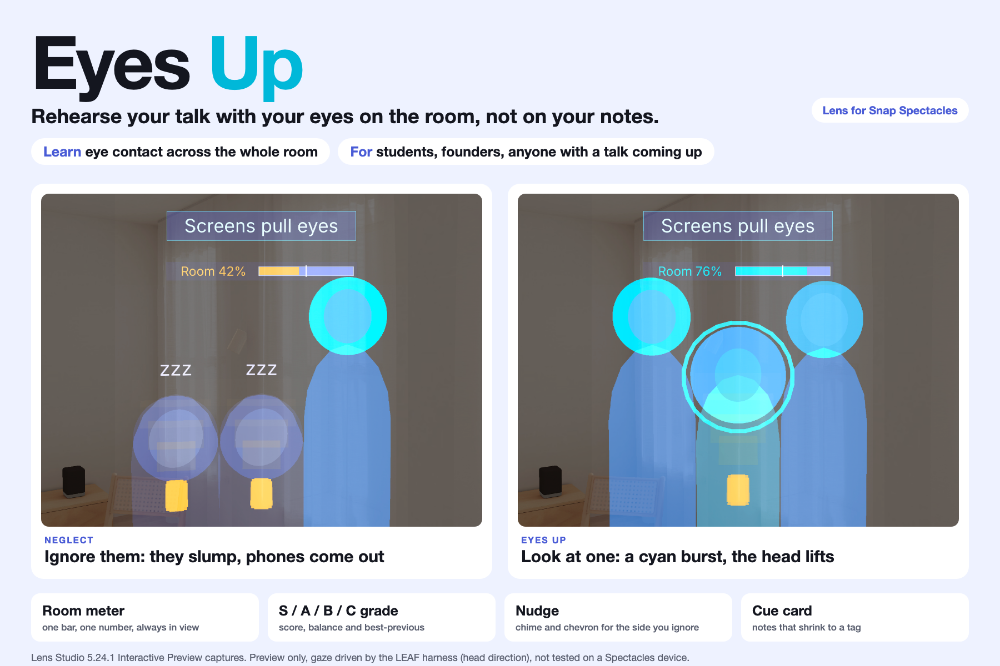
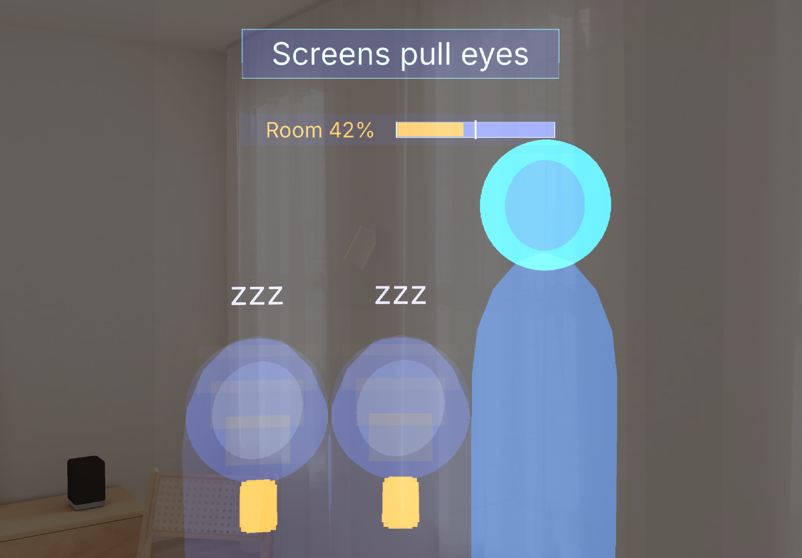
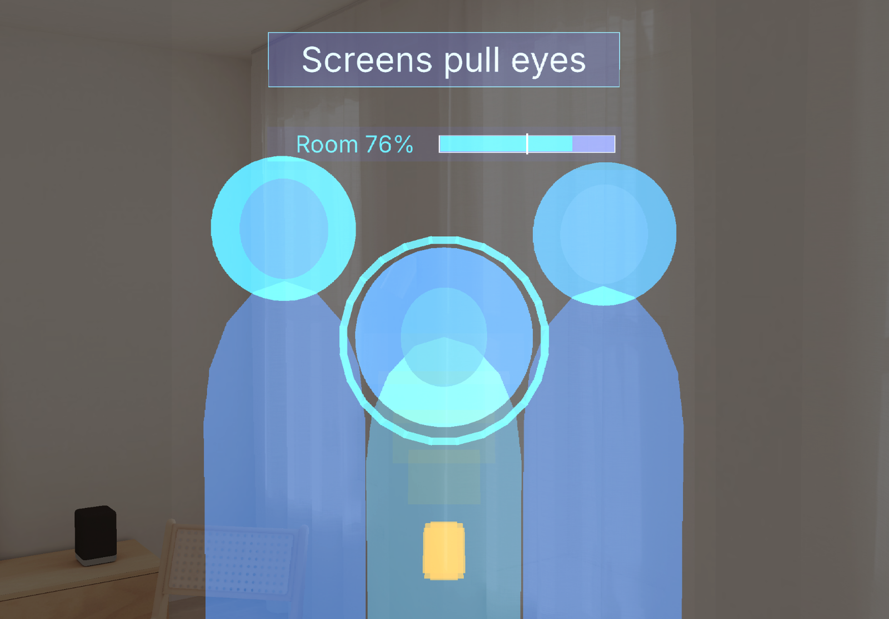
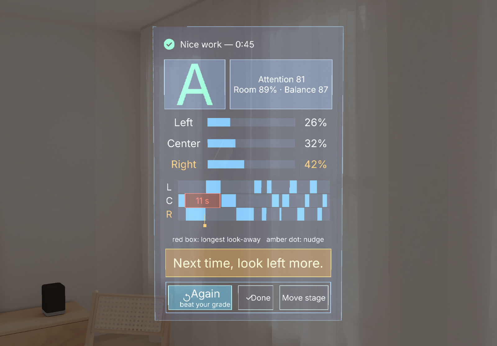

# Eyes Up — Devpost submission text

Hackathon: Learn AR with SPECS. Deadline 2026-11-09 PST.

## Tagline

Rehearse your talk with your eyes on the room, not on your notes.

**Ignore your audience and they slump; look at them and they perk up.**

**Learn:** spread your eye contact across the whole room. **For:** students, founders, anyone with a talk or an interview coming up.

*Neglect: two ignored members slump and light a phone, the room meter falls to 42 %.*

*Eyes up: look at one and it perks up with a cyan ring, the meter climbs to 76 %.*

*Payoff: a grade, where your eyes went, one tip, and Again to beat your grade.*

> **Judge in 60 seconds**
> 1. **See it:** gallery images 1 and 2 are the whole idea. Members you ignore slump, mute their colour and light a phone; the one you look at stays lit in cyan and the room meter shows how many are with you.
> 2. **See the payoff and the loop:** image 3 is the Summary (grade, split, timeline, tip). Image 4 puts Run 1 (C 39) next to Run 2 (A 84) after following the tip.
> 3. **Check it:** image 5 (process, 10 of 10 LEAF scenarios, 174 tests) and image 6 (how CLAD and the Lens Studio MCP were used). Preview only, gaze driven by the LEAF harness, untested on a device.

## In three lines

1. **Problem:** people rehearse talks staring at slides, a phone or a script, so the room never gets practice.
2. **Spatial moment:** on Spectacles a virtual audience sits 2.5 m ahead and **reacts to where you look**: the member you face lights up in cyan and perks up, the ones you ignore slump and light a phone, and after 8 seconds a chime and a chevron point to the side you forgot.
3. **Proof:** built with CLAD and the Lens Studio MCP; 10 of 10 LEAF scenarios pass in the Interactive Preview and 174 Node tests pass. Preview only, gaze = head direction driven by the LEAF harness, not tested on a device.

**Learning goal:** spread your eye contact across the whole room. **Feedback:** the audience reacts live, then you get one tip and a grade. **Practice:** press Again and beat your grade. *Limit: learning outcomes are not measured; preview only, gaze is head direction driven by the LEAF harness, untested on a device.*

## What it does

Eyes Up is a presentation rehearsal coach for Spectacles. Setup is three pinches (talk length
3 / 5 / 10 min, audience 3 / 6 / 9 with 3 selected so the whole room fits the view, deck: two samples or your own outline), then Start rehearsal.

- **Look:** a half circle of glassy silhouettes stands 2.5 m ahead. Whoever you look at lights up in cyan within a second.
- **Nudge:** ignore one side for 8 seconds and a soft chime plays from that side while an amber double chevron appears at the edge of your view.
- **Notes:** your next talking point floats above the audience for 4 seconds, then shrinks to a three-word tag. Look at it for a second and it opens again.
- **Podium:** look down like a wristwatch for Prev, Next, Finish, a section counter and the talk timer.
- **Audience and room:** ignored members slump (head sinks and tilts, colour mutes, "zzz", phone glow); look at them and they perk up with a cyan ring burst. A room meter shows how engaged everyone is: a white tick at 50 %, amber below 60 % and cyan from 60 %.
- **Summary:** applause that scales with your score, then an S / A / B / C grade, left / center / right split, gaze timeline, longest look-away and one tip. Again keeps your settings and shows your best earlier score from this session.

### Why only on glasses

- **It shares your view.** The Lens knows where you look, so it can light up the person you face and time the side you ignored.
- **It draws in your room.** The audience and the cue card sit at real scale (2.5 m ahead, 10 cm above heads), so your eyes stay up instead of dropping to a screen.
- **It leaves your body free.** You stand, walk and gesture while you rehearse. Nothing is held or typed.

### Gallery order

Every caption describes what the image shows in the Interactive Preview (preview only, gaze driven by the LEAF harness, not tested on a device). Captured from one fixed preview camera pose toward the plain curtain wall, so the room reads against a quiet background.

1. `devpost/screenshots/00-hero-eyes-up.png`: Eyes Up. Neglect (two members slumped with "zzz", room meter amber) beside the perk-up (cyan ring burst, meter cyan), with the Learn / For line.
2. `devpost/screenshots/10b-slump-to-perk-up.png`: One image, two moments: ignored members sink, tilt, drain colour and light a phone (meter 42 %); look at one and it perks up with a cyan ring (meter 76 %).
3. `devpost/screenshots/06-summary.png`: The payoff: a large grade, attention score, room and balance, zone split, gaze timeline with the longest look-away, one tip, and Again as the single filled button (`06b-summary-grade-zones.png` is the close crop).
4. `devpost/screenshots/12-run-compare.png`: The learning loop: Run 1 (C 39) beside Run 2 (A 84) with each tip. Scripted gaze, illustrative, not a user study.
5. `devpost/screenshots/09-process-at-a-glance.png`: Process: three fixes found in the Preview (halo, hit area, game layer), the loop table, 10 of 10 LEAF scenarios, 174 tests.
6. `devpost/screenshots/13-clad-mcp.png`: How CLAD and the Lens Studio MCP were used: architecture strip, four real steps, real log lines.
7. `devpost/screenshots/03-nudge-chevron.png`: The nudge: an amber double chevron and "left" appear for the side you ignored, clear of the "zzz".

Separate stills of the two moments in image 2 are `10-engagement-slump.png` and `11-perk-up.png`.

**More screenshots** (text links only): `devpost/screenshots/01-setup-panel.png` (Setup: talk length, audience size with 3 selected, deck, Start rehearsal), `02-audience-lit-halo.png` (the member you face lights up in cyan within about a second), `04-cue-card.png` (the cue card, then the room meter 3 cm below it), `05-podium.png` (Prev, Next, Finish, section counter and talk timer).

## The learning loop: Run 1 vs Run 2

Rehearse, read the Summary, press Again (it keeps your settings) and run the talk once more. One scripted example, played by the LEAF harness in the Interactive Preview (`capture_loop`, logged in `devpost/leaf-results.md`). **Scripted gaze, illustrative loop, not a user study.**

| | Grade | Balance | Left / Center / Right | Longest look-away | Nudges | Tip shown |
|---|---|---|---|---|---|---|
| Run 1: stares right, ignores the left | C (score 39) | 46 | 0 / 30 / 70 % | 28 s, left | 3 | "Next time, look left more." |
| Run 2: follows the tip | A (score 84, new best) | 89 | 41 / 26 / 33 % | 12 s, right | 1 | "Next time, look at the center more." |

Room engagement went from 76 % to 91 %. Gallery image 4 (`12-run-compare.png`) shows both Summaries side by side. The Lens does not measure whether a real speaker would learn this; it makes the feedback loop visible and repeatable.

## What I learned building AR

1. **Glasses punish pale colours and thin lines.** The display is additive, so black is clear and pale is washed out. A cyan-white halo read as a grey disc in the Preview, and a thin amber chevron box vanished on a bright wall. The lit state is now saturated cyan with the red channel low, slumped members keep a muted blue instead of grey, and the chevron is a bold icon with no box. Seen in `09-process-at-a-glance.png` (Fix 1) and `learnings.md`.
2. **Gaze is a head ray, so targets need an exact, generous hit area, and the whole scene has to fit a narrow view.** We hit-test the real pill rectangle instead of a cone, and the Setup default is a 3-person audience that sits 42 cm apart, because the lens viewport is only about 1.4 m wide at 2.5 m (a 6-person arc at 60 cm was cut off at the edge), and the stage stands 6 cm higher so slumped heads stay in frame. UIKit's rounded backplates did not draw on Lens Studio 5.24.1, so panels use plain quads and UIKit keeps layout and pinch input.
3. **Test the logic in Node, drive the Lens with CLAD and MCP.** Timing rules (8 s nudge, 4 s card, 1 s dwell, engagement decay) live in pure TypeScript and ran in milliseconds under Vitest. CLAD skills built the scene and the Lens Studio MCP tools edited it, moved the preview camera, ran LEAF scenarios and let us look at captures, which found all of the above. Full log in `devpost/learnings.md` and `devpost/build-notes.md`; the process card is `screenshots/09-process-at-a-glance.png`.

## How it was built

One glance: gallery image 6 (`screenshots/13-clad-mcp.png`) shows the architecture strip, four real steps and real log lines.

- **Pure-TypeScript core (no Lens Studio dependency):** state machine, gaze zones, halo attention, nudge rules, cue card, stage-line timer, session stats, engagement and room meter, score and grade, panel view models, chevron placement, deck import parser. 174 unit and integration tests, typecheck and lint pass in Node.
- **CLAD skills:** scene and UIKit panels built with the CLAD build skills (UIKit panels and buttons, Spectacles Interaction Kit pinch input).
- **Lens Studio MCP tools:** scene edits, `MovePreviewCamera`, `run_leaf_scenario`, compile checks and log reads, all driven through MCP; no hand-edited scene files.
- **LEAF:** 10 scenarios pass one at a time in the Interactive Preview (start places the audience, gaze fills the halo, neglect triggers a nudge, card then pill, dwell expands the pill, finish shows the summary, repeated nudge, Finish pulses at time, a neglected member slumps and recovers, Finish shows a grade).

## Who it is for

Anyone who has to speak to a room and keeps staring at slides, a phone or a script.

- **Student:** a thesis defence in front of a panel. Practise looking at every committee member, not only the supervisor.
- **Founder:** a pitch. Keep your eyes on the room instead of the deck, and see which side you forgot.
- **Interview:** a panel interview. Learn to share eye contact between interviewers, not the table.

A laptop teleprompter pulls your eyes down to a screen, which is the habit you want to break. Glasses keep the room in view, know where you look, and draw in the world, so this only makes sense on glasses.

## What we would test next

- Does the nudge change your gaze balance between a first and a second run of the same talk?
- Is an audience 2.5 m ahead legible and comfortable on real Spectacles optics?
- Does head direction match where the eyes actually look when you face a room?

We have not measured learning outcomes. These are open questions, not results.

## What is not done (honest list)

**Not tested**

- Not tested on a Spectacles device (none available). Gaze is head rotation, simulated in preview. Spatial direction of the chime and legibility at 2.5 m on real optics are unverified.
- The AR keyboard for deck import does not open in the Lens Studio preview. The outline parser is unit tested and the sample decks cover the demo.

**Not claimed**

- The attention score and grade are a design heuristic (balance times how engaged the virtual room stayed), not a validated measure of speaking skill. The best-previous compare lives only while the Lens is open; nothing is saved.
- The Run 1 vs Run 2 loop is one scripted run (gaze driven by the LEAF harness), not a user study and not evidence that people improve.
- The video shows the Lens Studio Interactive Preview. Gaze and pinches in it are driven by the LEAF test harness (head ray and pinch simulated), and the narration and sounds are synthesized locally.
- Screenshot 11 (and walkthrough 08) was captured with the perk-up burst stretched from 0.7 s to 3 s so the ring pulse could be photographed mid-burst; the look is unchanged.
- Screenshots use the Setup default of 3 people; with 6 or 9 members the outer ones sit beyond the preview's narrow lens viewport. Framing method and the Preview's additive-display limits are in `devpost/build-notes.md`.
- Voice features (filler-word counter) are not in this build.

## Links

- Repository: this repository (MIT).
- Demo video (1:33, under 3 min, narrated and captioned; opens on the hero halo frame and a drawn "Eyes drop" card, then live preview footage with a PREVIEW pill; a card with three real before/after pairs follows the Summary; closes on a Shown / Not yet tested card, then the halo hero frame with the repo link and "Preview only, LEAF 10/10"):
  YouTube URL: **TODO_PASTE_PUBLIC_YOUTUBE_URL_HERE** (upload needs the entrant's YouTube account;
  set it to Public or Unlisted before submitting).
- Walkthrough: `devpost/walkthrough/` (01-setup to 08-perk-up). Learnings: `devpost/learnings.md`. LEAF log: `devpost/leaf-results.md`. Screenshots: `devpost/screenshots/`. Build log: `devpost/build-notes.md`. Design brief:
  `devpost/design-brief.md`. Spec check against the plan: `docs/spec-matrix.md`.

## Built with

Lens Studio 5.24.1, TypeScript, UIKit, Spectacles Interaction Kit, LEAF, CLAD, Lens Studio MCP.
Started from the SPECS base template (template, SIK and UIKit are standard Snap packages). Sound
effects are generated locally and the narration is macOS text to speech, so there is no third-party
music. No logos or trademarks are shown in the video. Not used: Remote Service Gateway, SnapML, ASR.
