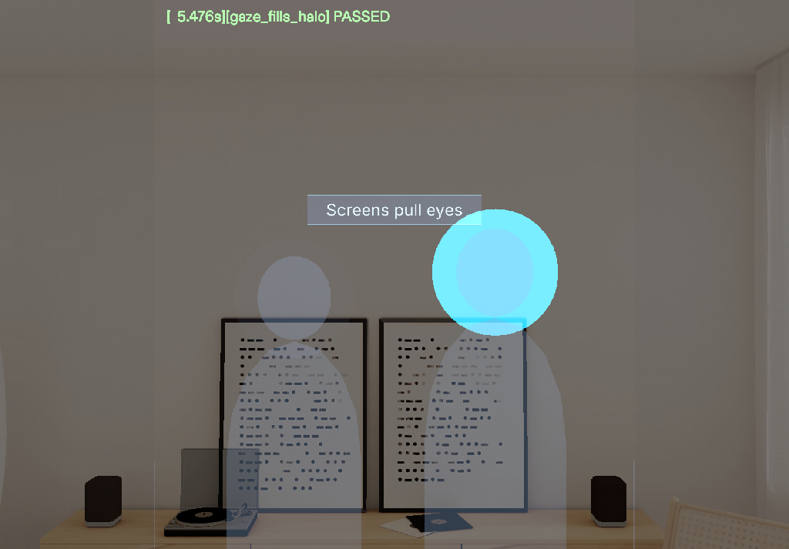

# Eyes Up — Devpost submission text

Hackathon: Learn AR with SPECS. Deadline 2026-11-09 PST.

## Tagline

Rehearse your talk with your eyes on the room, not on your notes.

## Pitch

- **Problem:** people rehearse talks staring at slides, a phone or a script, so the room never gets practice.
- **Spatial moment:** on Spectacles a virtual audience sits 2.5 m ahead, lights up where you look, and chimes and points when you ignore one side for 8 seconds.
- **Proof:** LEAF 8/8 scenarios pass in the Lens Studio Interactive Preview and 139 tests pass. Preview only, gaze driven by the LEAF harness, not tested on a device. Gaze = head direction in this build.

> **Judge in 60 seconds**
> 1. Video 0:00-0:16: live Setup panel, pinch Start, audience appears, halo lights up (`devpost/screenshots/08-halo-cyan.png`, the hero image above).
> 2. Video 1:00-1:16, Summary segment: left / center / right split, longest look-away, tip. Closing frame at 1:37 carries the repo link and "Preview only, LEAF 8/8".
> 3. `devpost/leaf-results.md`: 8/8 scenarios PASSED, plus `devpost/screenshots/09-process-at-a-glance.png`.

## What it does

Eyes Up is a presentation rehearsal coach for Spectacles. Setup is three pinches (talk length
3 / 5 / 10 min, audience 3 / 6 / 9, deck: two samples or your own outline), then Start rehearsal.

- **Look:** a half circle of glassy silhouettes stands 2.5 m ahead. Whoever you look at lights up in cyan within a second.
- **Nudge:** ignore one side for 8 seconds and a soft chime plays from that side while an amber double chevron appears at the edge of your view.
- **Notes:** your next talking point floats above the audience for 4 seconds, then shrinks to a three-word tag. Look at it for a second and it opens again.
- **Podium:** look down like a wristwatch for Prev, Next, Finish, a section counter and the talk timer.
- **Summary:** the audience applauds, then you see your left / center / right split, a gaze timeline, your longest look-away, how often you used the cards and a one-line tip.

### How you learn from it

Rehearse, see the split on the Summary, press Again (it keeps your settings) and run the talk once
more, then compare the Balance score between runs. The one-line tip ("Next time, look left more.")
is the feedback to carry into the next run. We have not measured learning outcomes; this is the
loop the Lens is built around.

### Why only on glasses

- **It shares your view.** The Lens knows where you look, so it can light up the person you face and time the side you ignored.
- **It draws in your room.** The audience and the cue card sit at real scale (2.5 m ahead, 10 cm above heads), so your eyes stay up instead of dropping to a screen.
- **It leaves your body free.** You stand, walk and gesture while you rehearse. Nothing is held or typed.

### Gallery order

1. `devpost/screenshots/08-halo-cyan.png` (the halo, the hook)
2. `devpost/screenshots/09-process-at-a-glance.png` (process: halo fix, hit-area fix, LEAF 8/8, 139 tests, Setup to Summary)
3. `devpost/screenshots/02-audience-lit-halo.png`
4. `devpost/screenshots/03-nudge-chevron.png`
5. `devpost/screenshots/04-cue-card.png`
6. `devpost/screenshots/05-podium.png`
7. `devpost/screenshots/06-summary.png`
8. `devpost/screenshots/01-setup-panel.png`

## Who it is for

Anyone who has to speak to a room and keeps staring at slides, a phone or a script: students giving
a thesis defence, founders pitching, teachers, people with a job interview coming up. A laptop
teleprompter pulls your eyes down to a screen, which is the habit you want to break. Glasses keep
the room in view, know where you look, and draw in the world, so this only makes sense on glasses.

## How it was built

A new Lens built with CLAD and the Lens Studio MCP skill pack, driven end to end through the Lens
Studio MCP tools. The scene uses UIKit panels and buttons, the audience, halo, nudge and cue card
are TypeScript components. All logic (state machine, gaze zones, halo attention, nudge rules, cue
card, stage-line timer, session stats, panel view models, deck import parser) is plain TypeScript
with no Lens Studio dependency, so Node tests it: 139 unit and integration tests, typecheck and
lint all pass. Eight LEAF scenarios pass in the Interactive Preview (start places the audience,
gaze fills the halo, neglect triggers a nudge, card then pill, dwell expands the pill, finish shows
the summary, repeated nudge, the Finish button pulses once the talk length is reached). The nudge chevron never covers a panel (placement rule in `devpost/build-notes.md`, unit tested).

## What we learned

- For a learner, feedback only helps when it becomes one action. One gaze number is easy to ignore, so the Summary ends with a single tip ("Next time, look left more.") that you can carry into the next run.
- Design for the glasses first. The 40 x 30 cm Setup panel, 10 cm above eye level, is the only
  thing on screen during setup. Keeping the world uncluttered mattered more than adding features.
- Additive displays punish pale colors. A cyan-white halo washed out to a grey disc on the
  preview, so the lit state is now saturated cyan (red channel kept low) and reads in seconds.
- Gaze is a head ray, so every target needs a generous hit area. We hit-test the real pill
  rectangle instead of a cone, which stopped the dwell from latching on the center audience.
- UIKit on Lens Studio 5.24.1 did not draw its rounded backplates, so panels use plain quads for
  surfaces while UIKit keeps layout, colliders and pinch input. Documented in build-notes.md.
- Test the logic away from the editor. The pure TypeScript core let us iterate on timing rules
  (8 s nudge, 4 s card, 1 s dwell) in milliseconds, and LEAF scenarios checked the real Lens.

## What we would test next

- Does the nudge change your gaze balance between a first and a second run of the same talk?
- Is an audience 2.5 m ahead legible and comfortable on real Spectacles optics?
- Does head direction match where the eyes actually look when you face a room?

We have not measured learning outcomes. These are open questions, not results.

## What is not done (honest list)

- Preview only, not tested on a Spectacles device (none available). Gaze is head rotation, simulated
  in preview. Spatial direction of the chime and legibility at 2.5 m on real optics are unverified.
- The video shows the Lens Studio Interactive Preview. Gaze and pinches in it are driven by the LEAF
  test harness (head ray and pinch simulated), and the narration and sounds are synthesized locally.
- Voice features (filler-word counter) are not in this build.
- The AR keyboard for deck import does not open in the Lens Studio preview. The outline parser is
  unit tested and the sample decks cover the demo.

## Links

- Repository: this repository (MIT).
- Demo video (1:41, under 3 min, narrated and captioned, opens on live preview footage; a PREVIEW pill stays on screen; closes on a Shown / Not yet tested card, then the halo hero frame with the repo link and "Preview only, LEAF 8/8"):
  YouTube URL: **TODO_PASTE_PUBLIC_YOUTUBE_URL_HERE** (upload needs the entrant's YouTube account;
  set it to Public or Unlisted before submitting).
- Walkthrough: `devpost/walkthrough/` (01-setup to 06-summary). Learnings: `devpost/learnings.md`. LEAF log: `devpost/leaf-results.md`. Screenshots: `devpost/screenshots/`. Build log: `devpost/build-notes.md`. Design brief:
  `devpost/design-brief.md`. Spec check against the plan: `docs/spec-matrix.md`.

## Built with

Lens Studio 5.24.1, TypeScript, UIKit, Spectacles Interaction Kit, LEAF, CLAD, Lens Studio MCP.
Started from the SPECS base template (template, SIK and UIKit are standard Snap packages). Sound
effects are generated locally and the narration is macOS text to speech, so there is no third-party
music. No logos or trademarks are shown in the video. Not used: Remote Service Gateway, SnapML, ASR.
